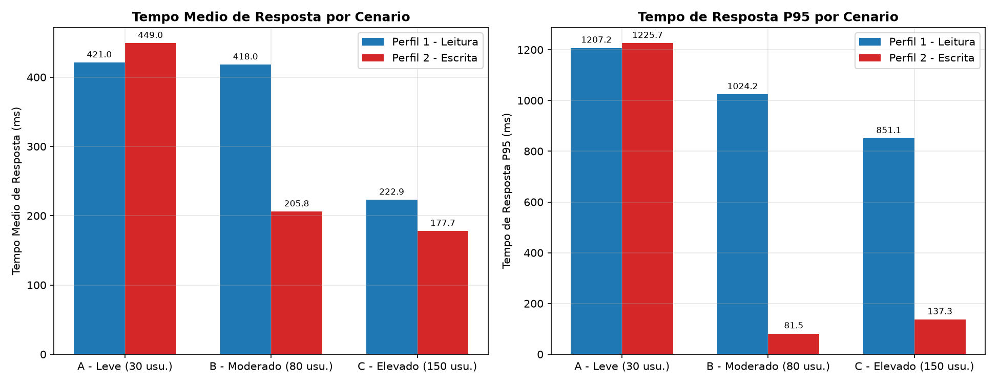
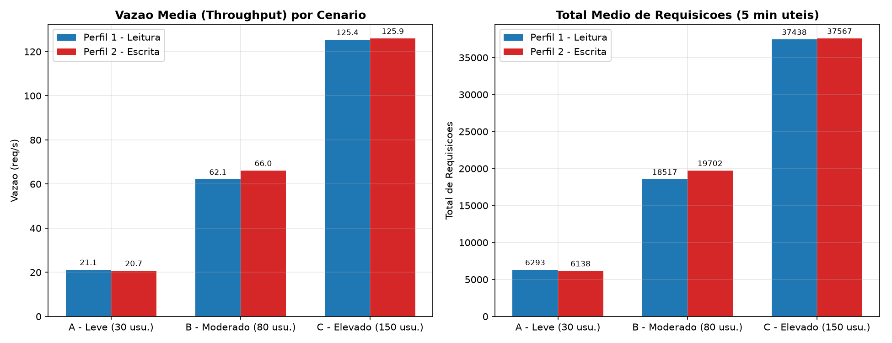
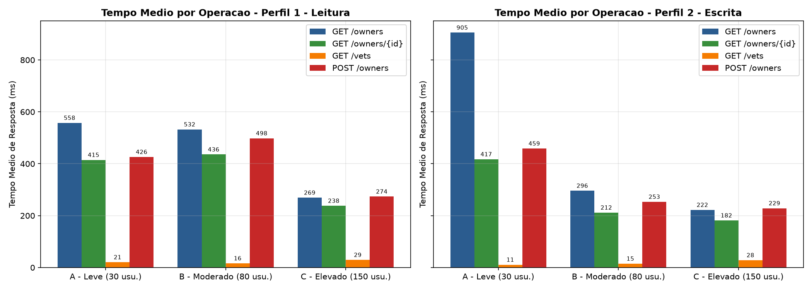
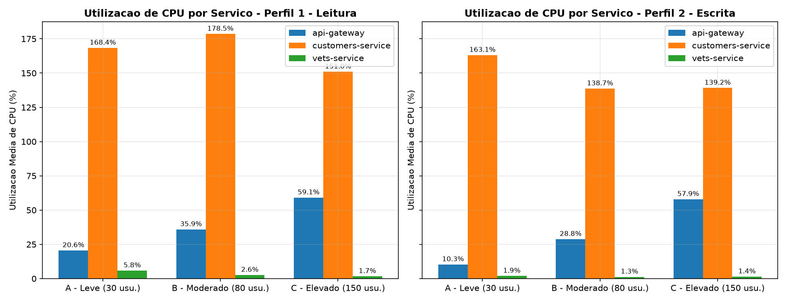
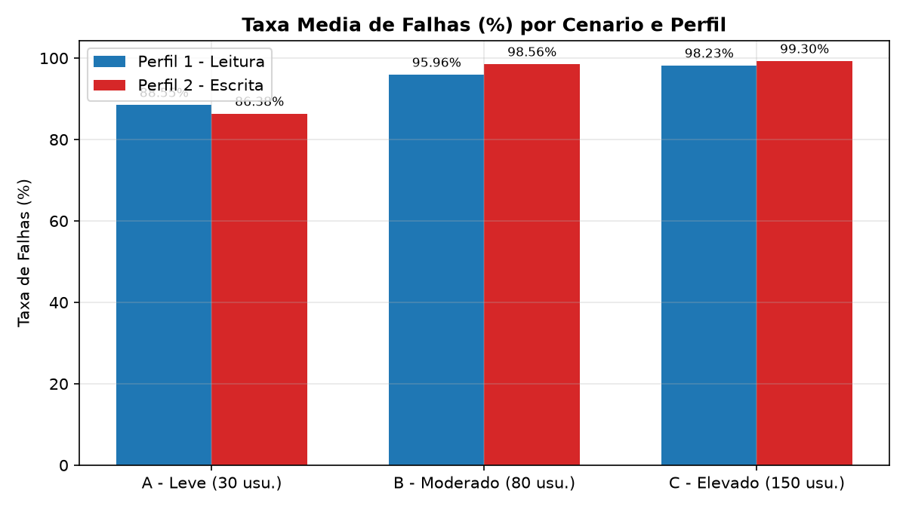

# Trabalho Prático 06 - Avaliação de Desempenho de Microsserviços com Locust

Avaliação de desempenho do **Spring PetClinic Microservices** utilizando o **Locust**, analisando o impacto da quantidade de usuários simultâneos e dos diferentes tipos de requisição (Leitura e Escrita).

## 1. Estrutura do Repositório

```text
├── docker-compose.yml            # Orquestração dos microsserviços do Spring PetClinic
├── locustfile.py                 # Implementação dos dois perfis de carga (Perfil1Leitura e Perfil2Escrita)
├── requirements.txt              # Dependências Python
├── scripts/
│   ├── run_all.ps1               # Script PowerShell para subir os serviços, rodar os testes e gerar gráficos
│   ├── run_experiments.py        # Execução das 60 rodadas e coleta de CPU via docker stats
│   └── analyze_results.py        # Cálculo das médias das repetições, geração de CSVs, tabelas e gráficos
├── results/
│   ├── raw/                      # CSVs brutos de cada repetição
│   ├── charts/                   # Gráficos comparativos (.png)
│   ├── summary_overall.csv       # Média geral por perfil e cenário
│   ├── summary_operations.csv    # Média detalhada por operação/endpoint
│   ├── summary_cpu.csv           # Média de uso de CPU e memória por serviço
│   └── tables.md                 # Tabelas consolidadas em Markdown
└── README.md                     # Documentação, metodologia, análise dos resultados e conclusões
```

## 2. Ambiente de Execução

- **Sistema Operacional:** Windows 11 (64 bits) com WSL2 / Docker Desktop
- **Orquestração:** Docker Compose (`Docker Engine v29.4.3`)
- **Ferramentas:** Python `3.12.10`, Locust `2.47.0`, Pandas `3.0.6`, Matplotlib `3.11.2`
- **Serviços Executados (Spring PetClinic Microservices):**
  - `config-server` (porta `8888`, limite `512M` RAM)
  - `discovery-server` / Eureka (porta `8761`, limite `512M` RAM)
  - `api-gateway` / Spring Cloud Gateway (porta `8085:8080`, limite `512M` RAM)
  - `customers-service` (porta `8081`, limite `512M` RAM, banco HSQLDB em memória)
  - `visits-service` (porta `8082`, limite `512M` RAM)
  - `vets-service` (porta `8083`, limite `512M` RAM, cache `@Cacheable("vets")`)
  - `tracing-server` / Zipkin (porta `9411`, limite `512M` RAM)
  - `admin-server` (porta `9090`, limite `512M` RAM)

## 3. Endpoints e Perfis de Carga

No Spring PetClinic Microservices, as requisições externas são recebidas pelo `api-gateway`, que redireciona as chamadas (`StripPrefix=2`) para os microsserviços correspondentes registrados no Eureka:

| Operação | Rota no `api-gateway` | Serviço de Destino | Perfil 1 - Leitura | Perfil 2 - Escrita |
| :--- | :--- | :--- | :---: | :---: |
| `GET /owners` | `GET /api/customer/owners` | `customers-service` | 45% (peso 9) | 20% (peso 1) |
| `GET /owners/{id}` | `GET /api/customer/owners/{id}` | `customers-service` | 35% (peso 7) | 20% (peso 1) |
| `GET /vets` | `GET /api/vet/vets` | `vets-service` | 15% (peso 3) | 20% (peso 1) |
| `POST /owners` | `POST /api/customer/owners` | `customers-service` | 5% (peso 1) | 40% (peso 2) |

## 4. Metodologia

### 4.1 Cenários Experimentais
Os dois perfis (`Perfil1Leitura` e `Perfil2Escrita`) foram executados em três níveis de carga, com intervalo de espera `between(0.5, 1.5)` segundos por usuário:

| Cenário | Usuários | Duração Total | Aquecimento | Tempo Útil Coletado | Repetições |
| :--- | :---: | :---: | :---: | :---: | :---: |
| **A - Leve** | 30 | 6 min (360s) | 1 min (60s) | 5 min (300s) | 10 |
| **B - Moderado** | 80 | 6 min (360s) | 1 min (60s) | 5 min (300s) | 10 |
| **C - Elevado** | 150 | 6 min (360s) | 1 min (60s) | 5 min (300s) | 10 |

Total: **2 perfis x 3 cenários x 10 repetições = 60 execuções**.

### 4.2 Descarte do Aquecimento e Coleta de CPU
- No `locustfile.py`, um listener no evento `test_start` aguarda os primeiros `60 segundos` de cada execução e chama `environment.runner.stats.reset_all()`. Dessa forma, o 1º minuto é descartado e os arquivos `*_stats.csv` registram apenas os 5 minutos finais de teste.
- Em paralelo, o script `scripts/run_experiments.py` aguarda o mesmo período de 60 segundos de aquecimento antes de iniciar a coleta de uso de CPU e memória via `docker stats --no-stream` a cada 2 segundos para os containers `api-gateway`, `customers-service`, `vets-service`, `visits-service` e `discovery-server`.

## 5. Instruções de Reprodução

### Passo 1 - Instalar dependências
```powershell
pip install -r requirements.txt
```

### Passo 2 - Iniciar os containers Docker
```powershell
docker compose up -d
```
Aguarde cerca de 60 a 90 segundos até que todos os serviços estejam registrados no Eureka (`http://localhost:8761`) e acessíveis pelo `api-gateway` (`http://localhost:8085`).

### Passo 3 - Executar os testes e processar os resultados
Para executar o fluxo completo pelo PowerShell:
```powershell
.\scripts\run_all.ps1
```

Ou chamando os scripts Python diretamente:
```powershell
python -u scripts/run_experiments.py --repetitions 10 --duration 360 --warmup 60
python scripts/analyze_results.py
```

## 6. Resultados Obtidos

### 6.1 Métricas Globais por Cenário e Perfil (Média das 10 Repetições)

| Perfil | Cenário | Usuários | Tempo Médio (ms) | P95 (ms) | Vazão (req/s) | Total Req. | Taxa de Falhas (%) | CPU `api-gateway` (%) | CPU `customers-service` (%) | CPU `vets-service` (%) |
| :--- | :--- | :---: | :---: | :---: | :---: | :---: | :---: | :---: | :---: | :---: |
| Perfil 1 - Leitura | A - Leve (30 usu.) | 30 | 420.98 | 1207.20 | 21.13 | 6293 | 88.55% | 20.58% | 168.37% | 5.85% |
| Perfil 1 - Leitura | B - Moderado (80 usu.) | 80 | 417.96 | 1024.20 | 62.06 | 18517 | 95.96% | 35.90% | 178.53% | 2.64% |
| Perfil 1 - Leitura | C - Elevado (150 usu.) | 150 | 222.89 | 851.10 | 125.40 | 37438 | 98.23% | 59.13% | 150.95% | 1.69% |
| Perfil 2 - Escrita | A - Leve (30 usu.) | 30 | 449.03 | 1225.70 | 20.68 | 6138 | 86.38% | 10.31% | 163.12% | 1.93% |
| Perfil 2 - Escrita | B - Moderado (80 usu.) | 80 | 205.84 | 81.50 | 66.02 | 19702 | 98.56% | 28.80% | 138.67% | 1.30% |
| Perfil 2 - Escrita | C - Elevado (150 usu.) | 150 | 177.73 | 137.30 | 125.91 | 37567 | 99.30% | 57.92% | 139.15% | 1.44% |

Observação sobre o estado inicial vs. acumulado: na primeira repetição com o banco em estado inicial (`rep01`), o Cenário A (30 usuários) operou com **0,00% de falhas** tanto no Perfil 1 (tempo médio de `400,22 ms`, P95 de `1500 ms`, vazão de `21,32 req/s` e CPU do `customers-service` em `363,91%`) quanto no Perfil 2 (tempo médio de `926,74 ms`, P95 de `4000 ms`, vazão de `15,43 req/s` e CPU do `customers-service` em `397,65%`). Com o aumento de usuários (80 e 150) e o acúmulo de registros inseridos via `POST /owners`, a listagem completa `GET /owners` (`findAll()`) passou a exceder o timeout de `1000 ms` do `defaultCircuitBreaker` (Resilience4j) configurado no `api-gateway`, abrindo o Circuit Breaker e redirecionando as chamadas para `/fallback`.

### 6.2 Métricas Detalhadas por Operação (Endpoint)

| Perfil | Cenário | Operação | Tempo Médio (ms) | P95 (ms) | Vazão (req/s) | Total Req. | Taxa de Falhas (%) |
| :--- | :--- | :--- | :---: | :---: | :---: | :---: | :---: |
| Perfil 1 - Leitura | A - Leve (30 usu.) | `GET /owners` | 557.72 | 6201.30 | 9.53 | 2836 | 89.72% |
| Perfil 1 - Leitura | A - Leve (30 usu.) | `GET /owners/{id}` | 414.88 | 2142.70 | 7.42 | 2211 | 88.70% |
| Perfil 1 - Leitura | A - Leve (30 usu.) | `GET /vets` | 20.59 | 47.00 | 3.12 | 928 | 84.52% |
| Perfil 1 - Leitura | A - Leve (30 usu.) | `POST /owners` | 426.29 | 3132.40 | 1.07 | 318 | 88.94% |
| Perfil 1 - Leitura | B - Moderado (80 usu.) | `GET /owners` | 532.42 | 1023.80 | 27.87 | 8314 | 96.74% |
| Perfil 1 - Leitura | B - Moderado (80 usu.) | `GET /owners/{id}` | 435.83 | 913.20 | 21.80 | 6504 | 95.85% |
| Perfil 1 - Leitura | B - Moderado (80 usu.) | `GET /vets` | 16.33 | 37.30 | 9.32 | 2780 | 93.99% |
| Perfil 1 - Leitura | B - Moderado (80 usu.) | `POST /owners` | 498.15 | 980.90 | 3.08 | 919 | 95.66% |
| Perfil 1 - Leitura | C - Elevado (150 usu.) | `GET /owners` | 269.29 | 899.30 | 56.31 | 16809 | 98.51% |
| Perfil 1 - Leitura | C - Elevado (150 usu.) | `GET /owners/{id}` | 238.05 | 796.90 | 43.99 | 13133 | 98.32% |
| Perfil 1 - Leitura | C - Elevado (150 usu.) | `GET /vets` | 29.43 | 103.90 | 18.83 | 5622 | 97.08% |
| Perfil 1 - Leitura | C - Elevado (150 usu.) | `POST /owners` | 273.56 | 831.30 | 6.28 | 1874 | 98.36% |
| Perfil 2 - Escrita | A - Leve (30 usu.) | `GET /owners` | 905.36 | 9640.00 | 4.12 | 1222 | 89.34% |
| Perfil 2 - Escrita | A - Leve (30 usu.) | `GET /owners/{id}` | 417.33 | 1110.70 | 4.17 | 1236 | 86.57% |
| Perfil 2 - Escrita | A - Leve (30 usu.) | `GET /vets` | 10.95 | 24.20 | 4.18 | 1240 | 82.93% |
| Perfil 2 - Escrita | A - Leve (30 usu.) | `POST /owners` | 458.63 | 1101.30 | 8.22 | 2440 | 86.57% |
| Perfil 2 - Escrita | B - Moderado (80 usu.) | `GET /owners` | 296.13 | 478.90 | 13.15 | 3923 | 99.72% |
| Perfil 2 - Escrita | B - Moderado (80 usu.) | `GET /owners/{id}` | 211.90 | 48.70 | 13.30 | 3970 | 98.88% |
| Perfil 2 - Escrita | B - Moderado (80 usu.) | `GET /vets` | 15.06 | 42.60 | 13.21 | 3943 | 96.99% |
| Perfil 2 - Escrita | B - Moderado (80 usu.) | `POST /owners` | 253.43 | 94.20 | 26.36 | 7866 | 98.60% |
| Perfil 2 - Escrita | C - Elevado (150 usu.) | `GET /owners` | 222.16 | 109.30 | 25.19 | 7517 | 99.95% |
| Perfil 2 - Escrita | C - Elevado (150 usu.) | `GET /owners/{id}` | 181.52 | 111.50 | 25.24 | 7532 | 99.50% |
| Perfil 2 - Escrita | C - Elevado (150 usu.) | `GET /vets` | 28.44 | 95.90 | 25.23 | 7529 | 98.05% |
| Perfil 2 - Escrita | C - Elevado (150 usu.) | `POST /owners` | 228.57 | 159.70 | 50.24 | 14990 | 99.49% |

### 6.3 Gráficos Comparativos

#### 1. Tempo Médio de Resposta e P95 por Cenário


No Cenário A (30 usuários), ambos os perfis apresentam os maiores tempos médios e P95 consolidados (`420,98 ms` / P95 `1207,20 ms` no Perfil 1 e `449,03 ms` / P95 `1225,70 ms` no Perfil 2), pois uma parcela maior de requisições aguarda o processamento completo no `customers-service`. Nos Cenários B (80 usu.) e C (150 usu.), o acionamento do Circuit Breaker no `api-gateway` retorna erros rapidamente (`~6 a 17 ms`), o que diminui o tempo médio global e o P95 contabilizado.

#### 2. Vazão (req/s) e Total de Requisições


A vazão total acompanha o aumento de usuários simultâneos: cerca de `21 req/s` (`~6.200` requisições em 5 min) para 30 usuários, `62 a 66 req/s` (`~18.500 a 19.700` requisições) para 80 usuários e `~125 req/s` (`~37.500` requisições) para 150 usuários.

#### 3. Degradação por Operação (Endpoint)


A operação `GET /owners` apresenta os maiores tempos médios de resposta em todos os cenários (`557,72 ms` no Perfil 1-A e `905,36 ms` no Perfil 2-A), seguida de `POST /owners` e `GET /owners/{id}`. Já `GET /vets` mantém tempos médios baixos (`10,95 ms` a `29,43 ms`) por utilizar cache no serviço de veterinários.

#### 4. Utilização de CPU dos Microsserviços


O `customers-service` concentra o maior uso de CPU em todos os cenários (`138%` a `178%` de média), por receber 85% das requisições do Perfil 1 e 80% das requisições do Perfil 2. O `api-gateway` apresenta crescimento contínuo conforme a carga sobe (`20,58% -> 35,90% -> 59,13%` no Perfil 1 e `10,31% -> 28,80% -> 57,92%` no Perfil 2), enquanto o `vets-service` permanece abaixo de `6%`.

#### 5. Taxa Média de Falhas (%)


A taxa de falhas aumenta com o número de usuários e com a carga de escrita, atingindo `99,30%` no Cenário C (150 usuários) do Perfil 2, em decorrência do redirecionamento para `/fallback` no `api-gateway`.

## 7. Respostas às Questões

### 1. Como o aumento de usuários afeta o tempo de resposta?
Quando o sistema opera sem abertura do Circuit Breaker (`rep01` do Cenário A com 30 usuários), o tempo médio de resposta é de `400,22 ms` (P95 `1500 ms`) no Perfil 1 e `926,74 ms` (P95 `4000 ms`) no Perfil 2. Na média das 10 repetições, o Cenário A registra `420,98 ms` (P95 `1207,20 ms`) no Perfil 1 e `449,03 ms` (P95 `1225,70 ms`) no Perfil 2. Quando a carga aumenta para 80 usuários (Cenário B) e 150 usuários (Cenário C), as requisições que chegam ao `customers-service` sofrem alta contenção e atingem picos de `10.000 ms` a `10.814 ms` (P99/Max). Como esse tempo supera o limite do `defaultCircuitBreaker` (Resilience4j) no `api-gateway`, o disjuntor abre e passa a rejeitar as chamadas imediatamente (`6 ms` a `17 ms`), o que faz a média aritmética global cair (`417,96 ms` e `222,89 ms` no Perfil 1 B/C; `205,84 ms` e `177,73 ms` no Perfil 2 B/C), embora o serviço de backend esteja saturado.

### 2. Qual perfil apresenta maior vazão?
Considerando as requisições processadas com sucesso pelo backend (como visto no Cenário A, com `21,13 req/s` e `6.293` requisições no Perfil 1 contra `20,68 req/s` e `6.138` no Perfil 2, e na `rep01` sem falhas com `21,32 req/s` no Perfil 1 contra `15,43 req/s` no Perfil 2), o **Perfil 1 - Leitura** apresenta maior vazão efetiva. Isso ocorre porque buscas por ID (`GET /owners/{id}`) e consultas em cache (`GET /vets`) exigem menos processamento do que inserções no banco (`POST /owners`, que compõem 40% do Perfil 2). Nos Cenários B e C, a vazão nominal bruta fica próxima entre os dois perfis (`62,06` e `125,40 req/s` no Perfil 1; `66,02` e `125,91 req/s` no Perfil 2) porque mais de 95% das chamadas recebem resposta imediata de erro do Circuit Breaker aberto no gateway.

### 3. Quais operações apresentam maior degradação?
As operações com maior degradação são:
1. **`GET /owners` (`GET /api/customer/owners`):** Apresenta o maior tempo médio no Cenário A (`557,72 ms` e P95 de `6201,30 ms` no Perfil 1; `905,36 ms` e P95 de `9640,00 ms` no Perfil 2). O método `ownerRepository.findAll()` retorna todos os registros sem paginação; assim, cada `POST /owners` aumenta o tamanho da lista retornada e o custo de serialização JSON.
2. **`POST /owners` (`POST /api/customer/owners`):** Apresenta a segunda maior degradação (`426,29 ms` no Perfil 1-A, `498,15 ms` no Perfil 1-B e `458,63 ms` no Perfil 2-A), pois envolve validação, transação de escrita no HSQLDB e possui filtro de `Retry (retries: 1)` configurado no `api-gateway` para métodos `POST`.
Por outro lado, **`GET /vets`** tem a menor degradação em todos os cenários (`10,95 ms` a `29,43 ms` de média), pois utiliza cache em memória (`@Cacheable("vets")`) no `vets-service`.

### 4. Como o consumo de CPU varia entre os cenários?
- **`customers-service`:** Apresenta o maior consumo de CPU em todos os cenários, com médias de `168,37%` (A), `178,53%` (B) e `150,95%` (C) no Perfil 1, e `163,12%` (A), `138,67%` (B) e `139,15%` (C) no Perfil 2 (chegando a mais de `360%` enquanto o Circuit Breaker está fechado). Nos cenários de 80 e 150 usuários, o consumo médio do `customers-service` não cresce indefinidamente porque o Circuit Breaker do gateway bloqueia parte das requisições antes de chegarem ao container.
- **`api-gateway`:** O uso de CPU cresce proporcionalmente ao aumento de usuários: passa de `20,58%` (30 usu.) para `35,90%` (80 usu.) e `59,13%` (150 usu.) no Perfil 1, e de `10,31%` (30 usu.) para `28,80%` (80 usu.) e `57,92%` (150 usu.) no Perfil 2.
- **`vets-service`:** Mantém consumo de CPU baixo em todos os testes (`1,30%` a `5,85%`), devido ao menor volume de chamadas e ao uso de cache.

### 5. Qual cenário apresenta maior taxa de falhas?
O **Cenário C - Elevado (150 usuários)** no **Perfil 2 - Escrita** apresenta a maior taxa de falhas (`99,30%`), seguido pelo Cenário B (80 usuários) no Perfil 2 (`98,56%`) e pelo Cenário C (150 usuários) no Perfil 1 (`98,23%`).
Nos registros de falhas do Locust (`*_failures.csv`), observa-se que essas falhas decorrem do acionamento do `defaultCircuitBreaker` no `api-gateway` quando o `customers-service` excede o tempo limite de resposta: o gateway redireciona as chamadas para `/fallback`, retornando `HTTP 503 Service Unavailable` para `POST /owners` e `HTTP 405 Method Not Allowed` para as rotas `GET`.

## 8. Conclusões

1. **Impacto da escrita sobre consultas não paginadas:** A inserção contínua de registros (`POST /owners`) afeta diretamente o desempenho de `GET /owners` por falta de paginação no `findAll()`, elevando o consumo de CPU e memória do `customers-service`.
2. **Atuação do Circuit Breaker no API Gateway:** Sob cargas de 80 e 150 usuários, o `defaultCircuitBreaker` do Spring Cloud Gateway conteve a sobrecarga no `customers-service`, mas gerou altas taxas de rejeição por timeout devido ao crescimento do banco em memória.
3. **Desempenho do cache e isolamento entre serviços:** O `vets-service` manteve tempos de resposta baixos (`10 a 29 ms`) e uso de CPU inferior a `6%` mesmo com 150 usuários simultâneos, demonstrando o benefício do cache (`@Cacheable`) e da separação em microsserviços.
